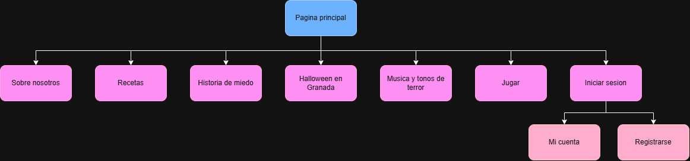

# Halloween
Proyecto de halloween de 2ºdaw

## Sitemap

## Labelling
| Label | Scope Note |
| ----- | ---------- |
| Pagina principal | Contiene header, formulario de correo "Jack Skellington" y footer comunes a todas las paginas ademas de secciones con descripcion e imagen con enlace a las otras paginas |
| Sobre nosotros | Una introduccion a los desarrolladores de la pagina |
| Recetas | Variedad de recetas con temática de Halloween |
| Tarjeta interactiva recetas | Recetas con su nombre y descripción, a lo que le añade que si pinchas en él, aparece su receta detrás de la tarjeta|
| Historia de miedo | Habra una historia de miedo diario que aparecera uno al día de forma aleatoria |
| Halloween en Granada | Lugares de terror en granada |
| Tarjeta interactiva Granada | Ubicaciones de Granada con su nombre, a lo que le añade que si pinchas en él, aparece su localización y una breve descripción detrás de la tarjeta|
| Musica y tonos de terror | Musica y sonidos conocidos de tematica de miedo |
| Jugar | Juego inspirado en el famoso juego "Snake" |
| Iniciar sesion | Botón de inicio de sesion, que se encuentra en todas las páginas, que te lleva a la página de inicio de sesión. Contiene un formulario en el que tienes que introducir tu nombre y contraseña |
| Restablecer contraseña | Enlace para restablecer contraseña olvidada. Para restablecerlo tienes que añadir tu nombre, pregunta de seguridad y tu respuesta |
| Nueva contraseña | Formulario donde introduces una nueva contraseña |
| Registrarse | Página para crear un usuario nuevo. Enlace que se encuentra en la página de iniciar sesión. Contiene un formulario en el que tienes que introducir tu nombre, email, contraseña y pregunta de seguridad |
| Mi cuenta | Pagina donde estan los datos introducidos del usuario y además se pueden editar |

 ## Diseño Lo - Fi
 [Ver diseño en Figma](https://www.figma.com/design/Uzvuu7TSRe4FtHqG0tAU6Q/GranaWeen-%E2%80%94-dise%C3%B1o-web?node-id=0-1&t=p36BfR8yMKP3eB8k-1)